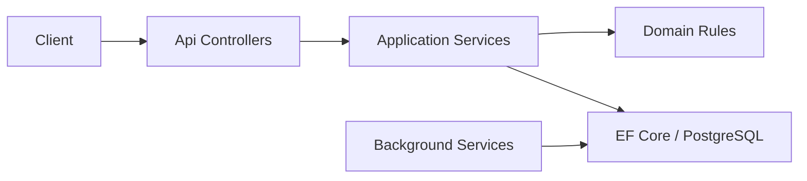

# Incident Management API

Production-oriented REST API for NOC / operations teams to track incidents, enforce SLA targets, maintain audit trails, and automate escalation and housekeeping.

## Stack

- **.NET 8** ASP.NET Core Web API
- **Entity Framework Core** + **PostgreSQL** (code-first migrations in `src/IncidentManagement.Infrastructure/Persistence/Migrations`)
- **JWT** bearer authentication with role-based authorization
- **Serilog** structured logging, **Swagger/OpenAPI**, health checks, ProblemDetails errors
- **Hosted background services** for SLA monitoring and auto-close housekeeping
- **Docker** multi-stage build + **docker-compose** for local runs
- **xUnit** unit tests + integration tests (`WebApplicationFactory` + PostgreSQL via Testcontainers in CI, or local Postgres)

## Solution layout

| Project | Responsibility |
|---------|----------------|
| `IncidentManagement.Api` | HTTP endpoints, auth, middleware, Swagger, health |
| `IncidentManagement.Application` | DTOs, services, FluentValidation, interfaces |
| `IncidentManagement.Domain` | Entities, enums, SLA + status transition rules |
| `IncidentManagement.Infrastructure` | EF Core, JWT/password hashing, background jobs, seed data |
| `IncidentManagement.UnitTests` | Domain and application rule tests |
| `IncidentManagement.IntegrationTests` | API + auth + database integration tests |

## Domain model

### Incident lifecycle

Statuses: `Open` → `Acknowledged` → `Investigating` → `Mitigated` → `Resolved` → `Closed` (validated transitions; see `IncidentStatusTransitionValidator`).

Severities **SEV1–SEV4** drive acknowledge/resolve SLA targets (e.g. SEV1: 15m / 4h).

### Roles

| Role | Capabilities |
|------|----------------|
| **Viewer** | List and read incidents |
| **Responder** | Create/update incidents, transition status, add comments |
| **Admin** | Responder capabilities + list users (`GET /api/auth/users`) |

## API endpoints

| Method | Path | Auth | Description |
|--------|------|------|-------------|
| `POST` | `/api/auth/login` | Anonymous | Obtain JWT |
| `GET` | `/api/auth/users` | Admin | List users |
| `GET` | `/api/incidents` | Authenticated | Paged list (filter, sort, search) |
| `GET` | `/api/incidents/{id}` | Authenticated | Incident detail + timeline + audits |
| `POST` | `/api/incidents` | Responder/Admin | Create incident |
| `PUT` | `/api/incidents/{id}` | Responder/Admin | Update incident |
| `POST` | `/api/incidents/{id}/status` | Responder/Admin | Validated status transition |
| `POST` | `/api/incidents/{id}/comments` | Responder/Admin | Add timeline comment |
| `GET` | `/health` | Anonymous | Liveness |
| `GET` | `/health/ready` | Anonymous | DB readiness |

### List query parameters

`page`, `pageSize`, `sortBy` (`createdAt`, `title`, `severity`, `status`, `acknowledgeSlaTarget`), `sortDirection` (`asc`/`desc`), `status`, `severity`, `assigneeId`, `isEscalated`, `search`.

## Background jobs

1. **SLA monitor** (`SlaMonitorBackgroundService`) — periodically flags acknowledge/resolve SLA breaches and escalates incidents.
2. **Housekeeping** (`HousekeepingBackgroundService`) — auto-closes incidents in `Resolved` status after `Housekeeping:AutoCloseResolvedAfterDays` (default 7).

Configure intervals via `SlaMonitor:RunIntervalMinutes` and `Housekeeping:RunIntervalMinutes`.

## Configuration

| Setting | Description |
|---------|-------------|
| `ConnectionStrings:Default` | PostgreSQL connection string |
| `Jwt:SigningKey` or `JWT_SIGNING_KEY` | HMAC signing key (**required**; never commit production secrets) |
| `Jwt:Issuer`, `Jwt:Audience`, `Jwt:ExpirationMinutes` | Token metadata |
| `Housekeeping:*`, `SlaMonitor:*` | Background job tuning |

## Run with Docker Compose

```bash
docker compose up --build
```

- API: http://localhost:8080  
- Swagger UI: http://localhost:8080/swagger  
- PostgreSQL (host): `localhost:5433` (user/password/db: `incident` / `incident` / `incident_management`)

On startup the API applies EF migrations and seeds development users.

### Seeded users (development only)

| Email | Password | Role |
|-------|----------|------|
| `admin@incident.local` | `Admin123!` | Admin |
| `responder@incident.local` | `Responder123!` | Responder |
| `viewer@incident.local` | `Viewer123!` | Viewer |

## Get a token

```bash
curl -s http://localhost:8080/api/auth/login \
  -H 'Content-Type: application/json' \
  -d '{"email":"responder@incident.local","password":"Responder123!"}'
```

Use the `accessToken` value as `Authorization: Bearer <token>` in Swagger or API calls.

### Example: create an incident

```bash
TOKEN="<accessToken from login>"

curl -s http://localhost:8080/api/incidents \
  -H "Authorization: Bearer $TOKEN" \
  -H 'Content-Type: application/json' \
  -d '{
    "title": "Payment gateway errors",
    "description": "Elevated 5xx from PSP in EU",
    "severity": "SEV2"
  }'
```

## Run locally (without Docker)

1. Start PostgreSQL and set `ConnectionStrings:Default`.
2. Set `Jwt:SigningKey` (32+ characters) in `appsettings.Development.json` or environment.
3. From the repo root:

```bash
dotnet run --project src/IncidentManagement.Api
```

Migrations run automatically at startup.

## Tests

```bash
dotnet test IncidentManagement.sln
```

**Integration tests**

- **CI** (`USE_TESTCONTAINERS=true`): PostgreSQL via Testcontainers.
- **Local**: default connection `Host=localhost;Port=5432;Database=incident_test;Username=incident;Password=incident`, or set `TEST_DATABASE_URL`.
- Force Testcontainers locally: `USE_TESTCONTAINERS=true`.

## CI

GitHub Actions workflow `.github/workflows/ci.yml` restores, builds, runs all tests, and builds the Docker image. An optional push step runs only when `DOCKER_REGISTRY`, `DOCKER_USERNAME`, and `DOCKER_PASSWORD` secrets are configured.

## Architecture (request flow)


